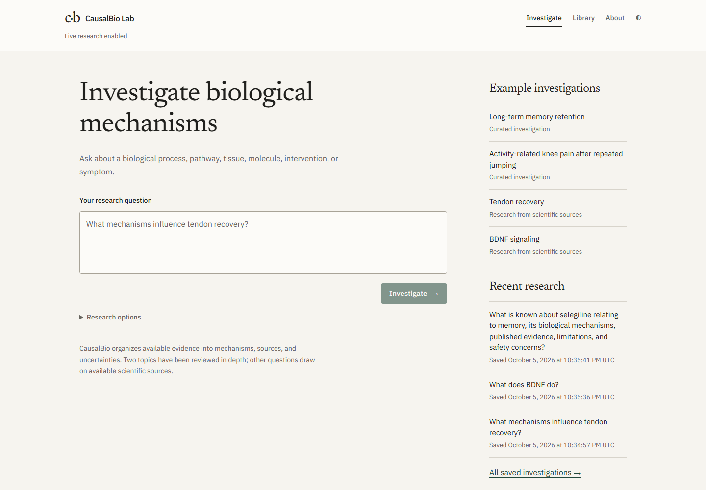
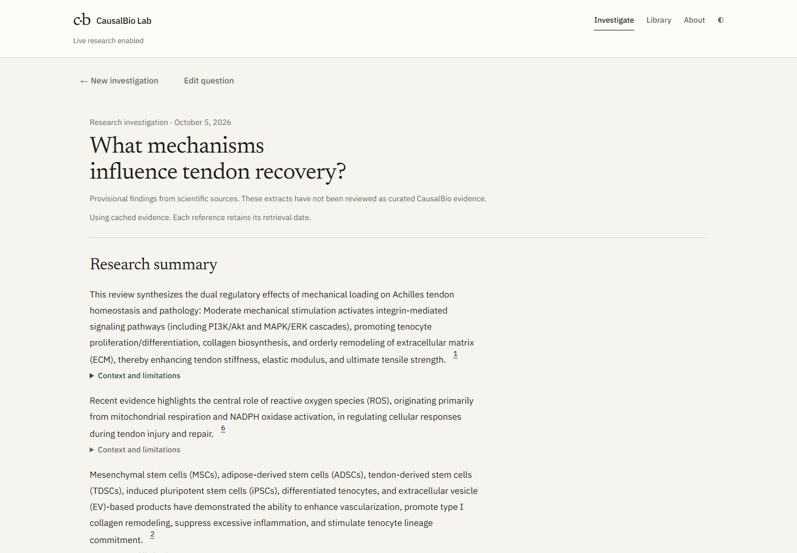
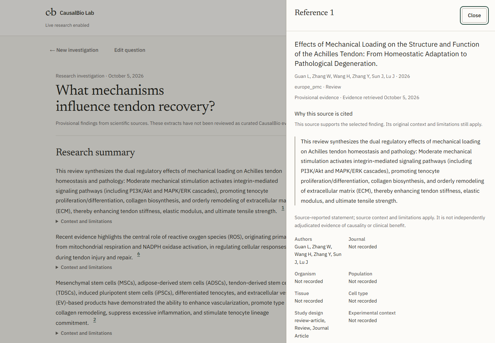
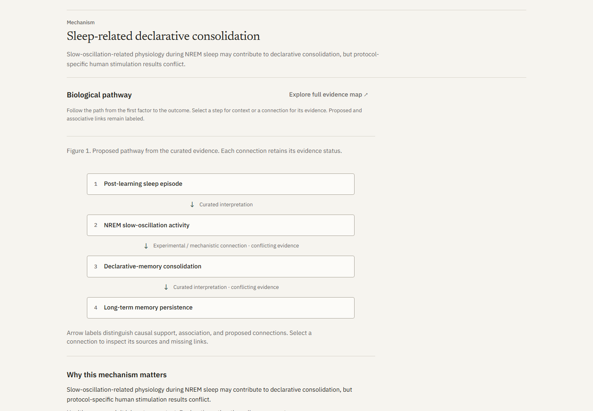
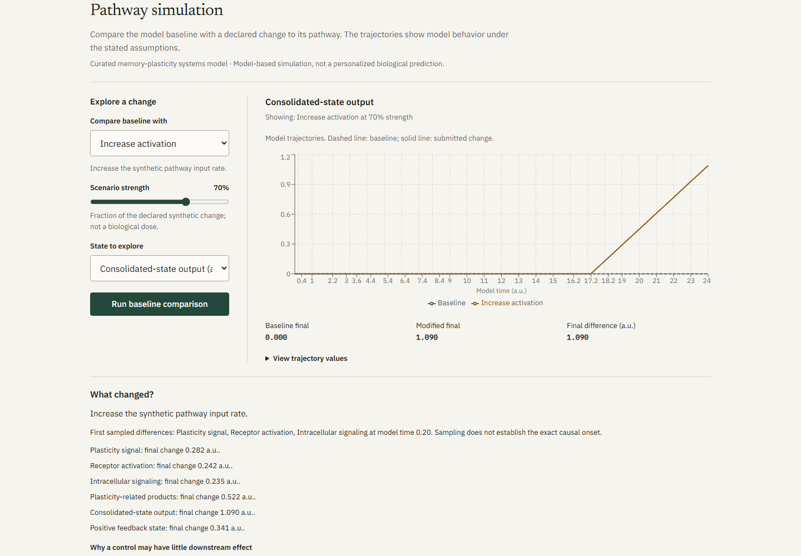
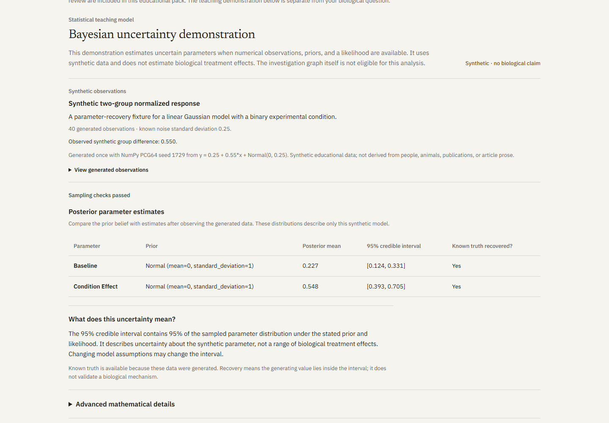

# CausalBio Lab

CausalBio Lab organizes biological questions into source-linked mechanism maps, competing explanations, and reproducible research summaries.

- Investigate curated topics or search scientific literature and protein annotations.
- Inspect the sources, conflicting evidence, and uncertainty behind a claim.
- Explore selected pathway models and a synthetic Bayesian demonstration, with their assumptions visible.


_Start with a biological question. Two curated investigations provide deeper examples; other questions use bounded scientific-source research._

[72-second demo](docs/assets/demo-walkthrough.mp4) ([transcript](docs/demo-transcript.md)) · [Technical documentation](docs/README.md) · [Validation](docs/validation.md)

## Why I built it

Biological evidence is distributed across papers, databases, organisms, tissues, and experimental contexts. A document search does not automatically explain how those findings fit together. CausalBio explores that gap: organize evidence into inspectable structures while preserving where each claim came from and what it cannot establish.

## My contribution

**OWNER REVIEW REQUIRED before publication:** Confirm the personal contribution statement and name before using this project in an application. The repository shows the implemented work, but cannot independently establish which parts its creator personally wrote or mastered.

Suggested statement to review: “I directed CausalBio's research workflow and product design, worked through implementation and debugging with coding assistants, and reviewed its source-traceability requirements, numerical boundaries, tests, and limitations.” Confirm or revise each claim. Do not imply sole authorship of every algorithm or formal mastery of all underlying mathematics. The [project defense guide](docs/project-defense-guide.md) supports studying and explaining the actual system.

## What happens to a question?

```text
Biological question → interpretation and safety routing
                          │
             ┌────────────┴────────────┐
             ▼                         ▼
       Curated pack             Bounded source research
       reviewed assertions      cited extracts and unknowns
             └────────────┬────────────┘
                          ▼
       Mechanisms → focused map → sources and uncertainty
                          ▼
          Saved summary and reproducibility record
                          ▼
       Optional numerical tools where a model exists
```

Curated assertions and provisional source links remain distinct. Retrieval never silently promotes an extract into a trusted causal claim. Restricted requests can offer a separate scientific question that requires an explicit user choice.

## Example: tendon recovery

For **“What mechanisms influence tendon recovery?”**, the October 5 production review retrieved **14 evidence records grouped into six provisional topics**. Those counts belong to that recorded run, not a promise about future results. Live sources and their availability change; cached results retain their original retrieval dates.


_The research brief presents source extracts and their citations. It does not treat a mixed set of experimental contexts as one human treatment model._

The example includes mechanical loading and mechanotransduction, matrix remodeling, and inflammatory signaling. A displayed source is Guan and colleagues' review, identified by [DOI 10.3390/jfmk11030273](https://doi.org/10.3390/jfmk11030273). Its presence supports inspecting what that paper reports; it does not establish a recommended recovery intervention. See the [recorded source review](docs/live-research-validation.md) and [image/source credits](THIRD_PARTY_NOTICES.md).


_The drawer preserves the cited passage, publication identifiers, retrieval date, and reported context. Missing information stays unknown._


_The curated memory example exposes a selected pathway, edge meanings, supporting studies, and weak links. This is distinct from a provisional topic-to-source map._

## Architecture

```text
Next.js / React / TypeScript
             │ typed JSON
             ▼
FastAPI — validation, safety boundary, sessions, exports
             │
             ▼
CausalBio Core
 ├─ Pydantic scientific models and evidence provenance
 ├─ routing, extraction, and mechanism ranking
 ├─ NetworkX assertion graph
 ├─ Petri / SciPy ODE simulation
 ├─ synthetic Hamiltonian Monte Carlo demonstration
 └─ reports and SQLite reproducibility snapshots
             │
             ▼
Curated packs · Europe PMC · PubMed · UniProt
```

The Python core is independent of HTTP and React. The frontend requests scientific results and changes their presentation without recomputing the underlying science. Graphs and numerical tools load on demand. [Architecture and trust boundaries →](docs/architecture.md)

## Technical highlights and methods

- **Graphs:** A directed typed multigraph, `G = (V, E)`, represents biological entities and contextual assertions. Parallel edges retain differing evidence and contexts. A causal-status field distinguishes mechanistic support, association, and hypotheses; an arrow alone proves nothing.
- **Ranking:** Curated paths combine evidence quality, directness, human relevance, context, and record-count support with contradiction, extrapolation, length, and unsupported-link penalties. The resulting plausibility index is a comparison heuristic, **not a probability**. [Graph and scoring method](docs/knowledge-graph.md)
- **Dynamics:** Petri places hold tokens or continuous state; transitions describe allowed changes. Continuous models use `dx/dt = S v(x)`: the stoichiometric matrix `S` maps implemented transition rates into changes in state. SciPy integrates constant/mass-action laws under declared bounds and gates. [Petri/ODE methodology](docs/petri-nets.md)
- **Bayesian demonstration:** `posterior ∝ likelihood × prior`. Four HMC chains explore two parameters of an explicit synthetic linear-Gaussian model. Known generating values and an analytic reference enable recovery and numerical checks. R-hat, effective sample size, energy diagnostics, and posterior predictions expose problems rather than certifying convergence. This does **not** infer biological posteriors from arbitrary literature. [Bayesian methodology](docs/bayesian-inference.md)
- **Research engineering:** Bounded retrieval, schema validation, deduplication, timeouts, partial failure, and validated caches preserve citation identity and original dates. Immutable research snapshots support reopening and HTML/Markdown/JSON reports. A separate closed registry analyzes two known peptides; it does not generate sequences.


_The simulation compares states inside a declared educational model. It is not a forecast for a person._


_Posterior intervals and diagnostics describe the synthetic numerical problem, not the truth of a biological mechanism._

## Validation

The October 8 release check passed **384 Python tests, 54 frontend tests, nine production browser workflows, and 11 offline evaluations** in a fresh Windows source copy, plus Ruff, strict mypy, TypeScript, ESLint, Prettier, the Next.js 16.3.8 production build, and both curated graph validations. No private configuration, cache, database, or installed dependency was copied into that environment. [Commands and results](docs/validation.md)

Tests exercise citation provenance, malformed API responses, graph identity and bounds, source failures, offline behavior, restricted routing, report persistence, keyboard focus, finite-difference gradients, leapfrog reversibility, synthetic parameter recovery, and Petri conservation/equilibria. They validate software behavior under stated assumptions; they do not establish clinical truth.

Release-pass Python statement coverage is **94.65%**: 4,598 of 4,858 statements, measured October 7 in the fresh copy; the scientific source was unchanged in the October 8 verification. No hosted CI pass or independent expert review is claimed. The [dependency audit](docs/dependency-audit.md) reports zero known production JavaScript/Python findings and one unresolved development-only advisory.

## Run it locally

**Requirements:** Python `>=3.11,<3.14`; Node `>=22.19,<25`; pnpm **11.2.2**. Local validation uses Python **3.11.9**, Node **24.16.0**, and pnpm **11.2.2**. Python/Node minimum declarations are not a claim that every supported combination has been tested.

Windows PowerShell, from the repository root:

```powershell
py -3.11 -m venv .venv
.\.venv\Scripts\python.exe -m pip install --upgrade pip
.\.venv\Scripts\python.exe -m pip uninstall -y setuptools
.\.venv\Scripts\python.exe -m pip install -e ".[dev]"
pnpm install --frozen-lockfile
pnpm seed
pnpm dev
```

Open **http://localhost:3000**. API: http://127.0.0.1:8000. Interactive API docs: http://127.0.0.1:8000/api/docs.

No private `.env`, API key, account, or LLM is required. Hatchling builds this project; setup removes unused bootstrap setuptools to avoid retaining its known tooling vulnerabilities. Live research sends scientific search terms to public providers; turn it off in Research options for offline use. A fresh offline installation has the curated packs, but no cached results for new topics. Installing dependencies and building the locally served fonts require internet access.

For browser tests, first install Chromium:

```powershell
pnpm --filter @causalbio/web exec playwright install chromium
pnpm verify
pnpm graph:validate
pnpm python:coverage
pnpm docs:check
pnpm public:check
```

The [reproducibility record](docs/reproducibility.md) distinguishes a tested clean Windows source copy from configured but unverified platforms, explains the portable Python commands, and records installation/startup results. Docker files are provided; local container validation is not claimed.

## Limitations

- Live retrieval is bounded, not a systematic review; grouping can miss context or relevant studies.
- Species, tissue, population, and intervention differences matter. Citation traceability is not proof of causation or independent replication.
- Curated packs are deeper but remain small educational curation sets. General research does not create a justified numerical model automatically.
- Petri/ODE models depend on explicit assumptions. HMC is restricted to the synthetic demonstration.
- Dense full graphs require zoom or the text alternative. Broad source extracts can be lengthy on mobile.
- This is local research software without authentication or multi-user isolation. It does not diagnose, prescribe, or provide dosing, synthesis, or procurement instructions.

[Scientific limitations](docs/limitations.md) · [Security](SECURITY.md)

## What I learned

**Owner-review draft:** The documented development lessons are concrete: a two-topic interface was too restrictive; curated assertions needed separation from provisional retrieval; early extraction sometimes preferred review-method sentences over useful biology; graph density hurt comprehension; and passing tests did not resolve scientific uncertainty. Personal wording should describe what the creator actually understood, changed, and learned. [Failures, decisions, and explanation guide](docs/project-defense-guide.md)

## Next steps

Near term: improve context extraction and mechanism explanations, dense graph layouts, and cross-browser/accessibility review. Research infrastructure: better study-context curation and carefully validated sources. Longer term: deeper domain packs, independent expert review, and numerical biological models only where data justify them. [Roadmap](docs/roadmap.md)

## Explore or contribute

[Documentation index](docs/README.md) · [Contributing](CONTRIBUTING.md) · [Public-release audit](docs/public-release-audit.md) · [Portfolio case study](docs/portfolio-case-study.md) · [Release notes](CHANGELOG.md)

The prepared **v1.0.0 — Public Research MVP** has not been tagged or published. Repository creation, contribution confirmation, remote CI, demo hosting, and release publication remain [owner publishing steps](docs/github-publishing-checklist.md).

Licensed under **Apache-2.0**; see [LICENSE](LICENSE) and [third-party notices](THIRD_PARTY_NOTICES.md). Publication and database content retains its own terms.
